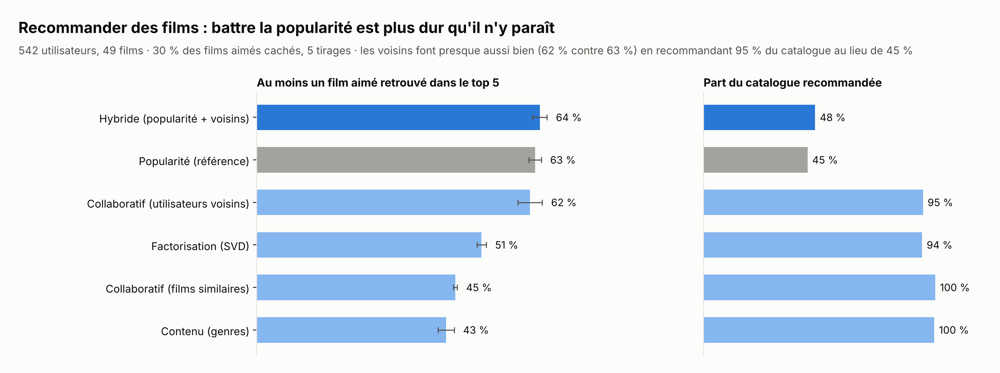
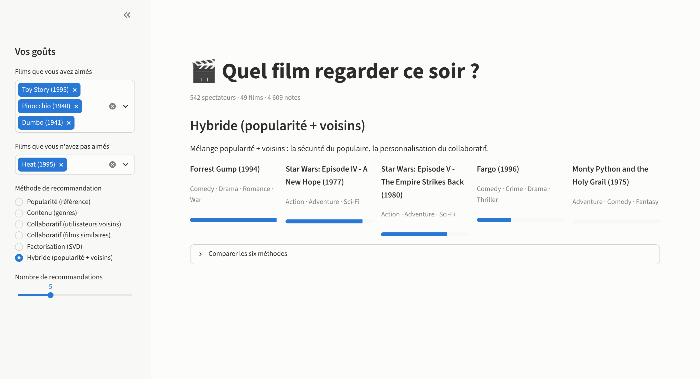
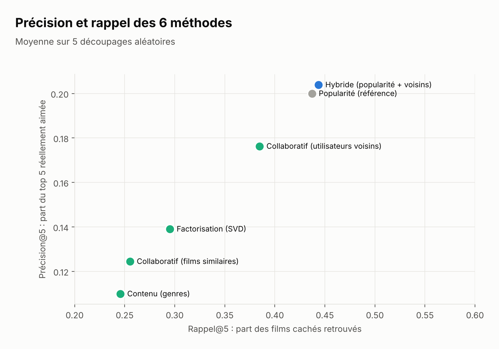

# 🎬 Recommandation de films : six méthodes face à la popularité



[](https://github.com/madjiguenedotesene/recommandation-films/actions/workflows/ci.yml)


Une application de recommandation de films (Streamlit) et, surtout, une **évaluation honnête** de six méthodes : filtrage par contenu, filtrage collaboratif (utilisateurs ou films), factorisation de matrice (SVD), méthode hybride, et la référence que l'on oublie souvent de battre : **la popularité**.



## 📊 Résultats

Pour 346 spectateurs, 30 % des films qu'ils ont aimés sont cachés ; chaque méthode propose 5 films ; moyenne sur 5 tirages.

| Méthode | Taux de réussite (≥ 1 film aimé dans le top 5) | Précision@5 | Rappel@5 | Catalogue couvert |
|---|---|---|---|---|
| **Hybride (popularité + voisins)** | **64 %** | 0,20 | 0,44 | 48 % |
| Popularité (référence) | 63 % | 0,20 | 0,44 | 45 % |
| Collaboratif (utilisateurs voisins) | 62 % | 0,18 | 0,39 | **95 %** |
| Factorisation (SVD) | 51 % | 0,14 | 0,30 | 94 % |
| Collaboratif (films similaires) | 45 % | 0,13 | 0,26 | 100 % |
| Contenu (genres) | 43 % | 0,11 | 0,25 | 100 % |

**Ce qu'il faut retenir :**

- **La popularité est un adversaire redoutable** sur un petit catalogue (49 films) : elle recommande les mêmes grands classiques à tout le monde, et ça marche souvent.
- **Les voisins font presque aussi bien en personnalisant vraiment** : 62 % de réussite en recommandant 95 % du catalogue, contre 45 % pour la popularité. C'est l'intérêt réel de la personnalisation : faire découvrir des films moins connus.
- **L'hybride prend le meilleur des deux**, sans gain spectaculaire : avec si peu de films et de notes par personne (6 en médiane), les méthodes sophistiquées (SVD) n'ont pas assez de signal.



## 🧠 Les six méthodes

| Méthode | Principe |
|---|---|
| Popularité | moyenne bayésienne des notes : les films bien notés par beaucoup de monde |
| Contenu | similarité TF-IDF des genres avec les films aimés |
| Utilisateurs voisins | notes des 20 spectateurs aux goûts les plus proches (cosinus sur notes centrées) |
| Films similaires | films notés de la même façon par les mêmes spectateurs (item-item) |
| SVD | goûts et films projetés dans 10 facteurs latents |
| Hybride | moyenne des scores standardisés de la popularité et des voisins |

## 🚀 Lancer

```bash
git clone https://github.com/madjiguenedotesene/recommandation-films.git
cd recommandation-films
pip install -r requirements.txt
streamlit run app.py          # application ; affiches si TMDB_API_KEY est définie
python run_all.py             # évaluation et figures (~20 s)
pytest -q                     # 4 tests
```

Pour afficher les affiches des films, créez une clé gratuite sur [themoviedb.org](https://www.themoviedb.org/settings/api) puis `export TMDB_API_KEY=votre_cle`.

## 🧭 Par rapport à la version d'origine

Version initiale réalisée en binôme avec **Youssouf Moussa ALI HAKI** (avril 2025) : une application Streamlit avec comptes utilisateurs et quatre algorithmes. Cette version :

- **sépare le moteur de recommandation de l'interface** (`src/`, testé) ;
- **ajoute une évaluation hors ligne** (précision, rappel, couverture) et une référence de popularité, absente de la version d'origine ;
- **corrige un défaut** : un profil d'une seule note produisait des recommandations par ordre alphabétique (vecteur centré nul) ;
- **retire les comptes utilisateurs**, qui stockaient des empreintes SHA-256 sans sel dans des fichiers JSON, et la clé d'API TMDB écrite dans le code (désormais lue dans une variable d'environnement).

## 📦 Données

4 609 notes de 542 spectateurs sur 49 films, extraites du jeu [MovieLens](https://grouplens.org/datasets/movielens/) (GroupLens Research, Université du Minnesota), utilisé ici à des fins pédagogiques non commerciales.

## 📁 Structure

```
├── app.py                 # application Streamlit
├── run_all.py             # évaluation et figures
├── src/
│   ├── recommandeurs.py   # 6 méthodes, interface commune ajuster / recommander
│   ├── evaluation.py      # découpage, précision, rappel, couverture
│   └── style.py           # charte graphique
├── data/notes_films.csv
├── tests/
├── results/
└── docs/img/
```

## 👤 Auteurs

**Madjiguene SENE** et Youssouf Moussa ALI HAKI · [LinkedIn](https://www.linkedin.com/in/madjiguene-dote-sene/) · [GitHub](https://github.com/madjiguenedotesene)
